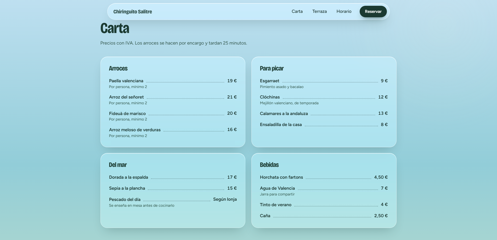
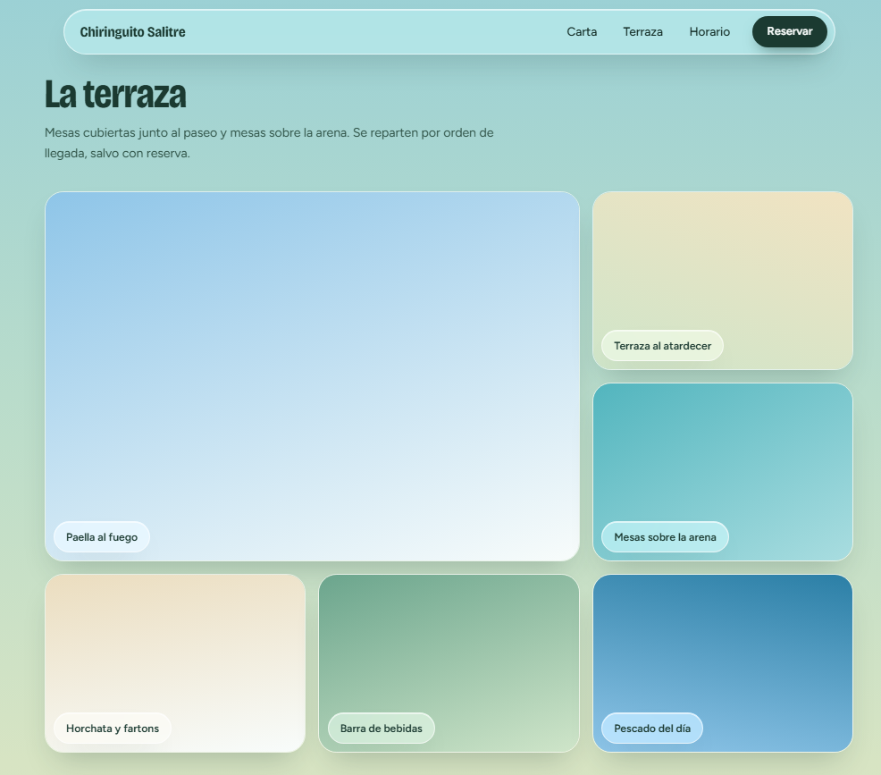
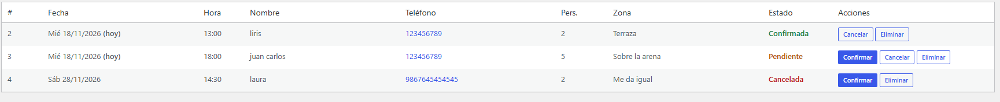
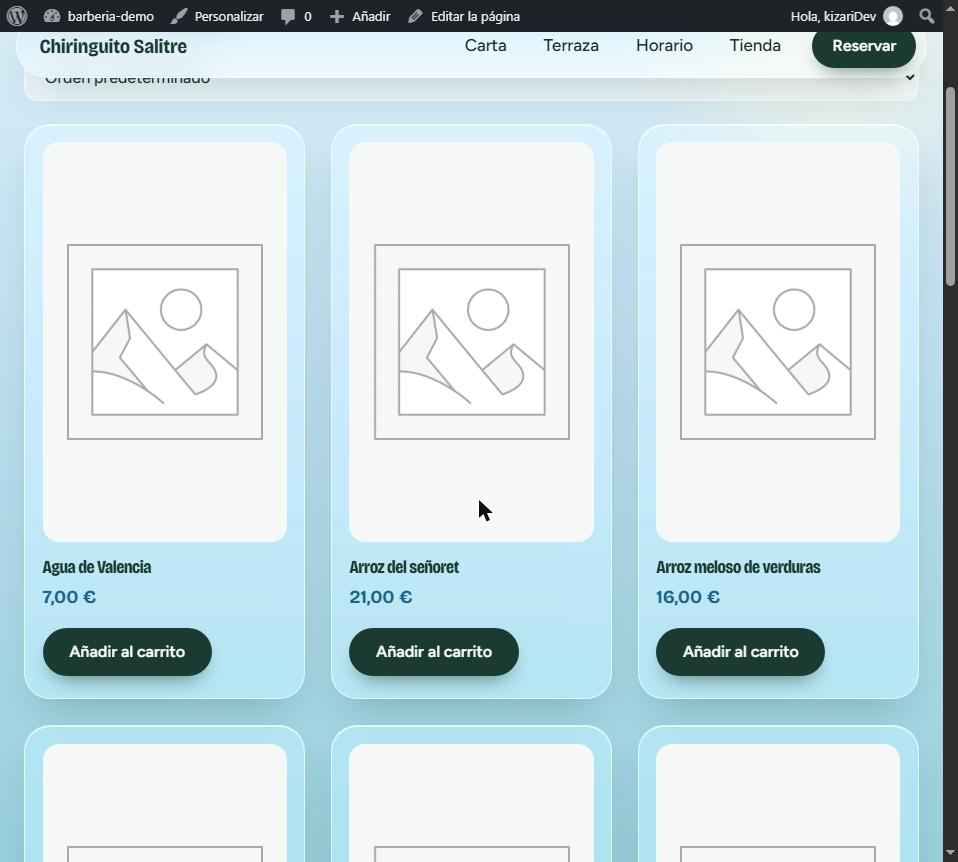

# Chiringuito Glass — Tema de WordPress con reservas en MySQL y tienda WooCommerce

Tema **de WordPress** para chiringuitos y restaurantes de playa, desarrollado a medida en **PHP, MySQL, HTML5, CSS3 y JavaScript**. Versión **1.2.0**: una sola página de presentación (inicio, carta, terraza, reservas), reservas guardadas en base de datos con panel propio de administración, y una **tienda WooCommerce** integrada con el mismo diseño glassmorphism para vender la carta online.

## Capturas

| | |
|---|---|
|  |  |
|  |  |

**Panel «Reservas» en el administrador de WordPress** (estados: confirmada, pendiente, cancelada):



**Tienda WooCommerce** con el mismo estilo glassmorphism que el resto del sitio:



## Características
- Estilo **glassmorphism** (paneles translúcidos con desenfoque) y **olas animadas**.
- Secciones de inicio, carta, terraza y reservas en una sola página; datos editables en `inc/datos.php`.
- Indicador de estado abierto/cerrado y diseño **responsive**.

## Sistema de reservas (v1.1.0)
- **Tabla MySQL** `wp_reservas` (nombre, teléfono, personas, fecha, hora, zona, estado, fecha de alta), creada con `dbDelta()` al activar el tema.
- **Formulario por AJAX** (`fetch` → `admin-ajax.php`): guarda la reserva sin recargar la página y muestra confirmación o error.
- **Panel «Reservas»** en el admin (`add_menu_page`): listado ordenado por fecha, contadores (hoy, pendientes, confirmadas, canceladas), filtro por fecha y estado, y acciones confirmar / cancelar / eliminar. Solo accesible con permiso `manage_options`.

### Flujo
```
formulario (main.js) → admin-ajax.php?action=chir_reserva → chir_reserva_recibir() → INSERT en wp_reservas
admin → menú «Reservas» → chir_reservas_pagina() → SELECT con filtros → acciones vía admin-post.php
```

### Seguridad
- **Nonce** en el formulario y en cada acción del panel (`check_ajax_referer`, `check_admin_referer`).
- **Consultas preparadas** con `$wpdb->insert / update / delete / prepare`.
- **Validación en servidor** de nombre, teléfono, personas, fecha (no pasada, máximo 6 meses, día abierto), hora y zona.
- **Honeypot** anti-bots y **límite de 5 envíos por hora y por IP** (transients).
- Salida escapada con `esc_html`, `esc_attr` y `esc_url`.

## Tienda WooCommerce (v1.2.0)
- `add_theme_support( 'woocommerce' )` con galería de producto (zoom, lightbox, slider) y rejilla configurable.
- Plantillas propias que reutilizan la cabecera y el pie del tema: `header.php`, `footer.php`, `page.php` (páginas normales: carrito, pago, mi cuenta) y `woocommerce.php` (tienda, categorías y ficha de producto).
- Estilos de WooCommerce desactivados (`woocommerce_enqueue_styles`) y sustituidos por reglas propias en `assets/css/main.css`: tarjetas de producto en estilo cristal, botones y formularios con la misma paleta que el resto del sitio.
- Moneda del catálogo en euros, formato español (`19,00 €`).
- Carta importable como CSV de WooCommerce (nombre, SKU, precio, categoría) a partir de `inc/datos.php`.

## Estructura
```
functions.php        carga de estilos, scripts, inc/ y soporte de WooCommerce
header.php / footer.php   cabecera y pie compartidos por todas las plantillas
index.php             plantilla de la página de inicio (one-page)
page.php              plantilla de páginas normales (carrito, pago, mi cuenta...)
woocommerce.php       plantilla de la tienda, categorías y ficha de producto
inc/datos.php         datos del negocio (único archivo a editar para otra marca)
inc/reservas.php      tabla, recepción AJAX y panel de administración
assets/               CSS y JavaScript
```

## Instalación
Copiar en `wp-content/themes/`, activar y editar `inc/datos.php`. WordPress 6.0+, PHP 7.4+, MySQL/MariaDB. Para la tienda, instalar y activar el plugin **WooCommerce** e importar el catálogo como CSV.

---
Rafael Izquierdo · KizaryDev
